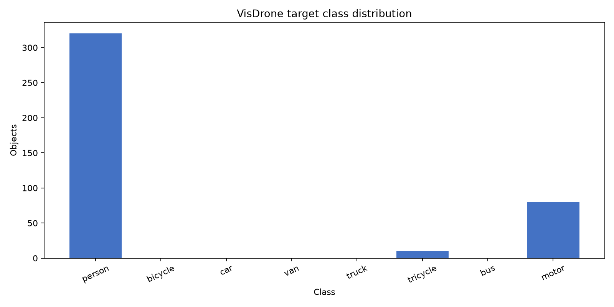
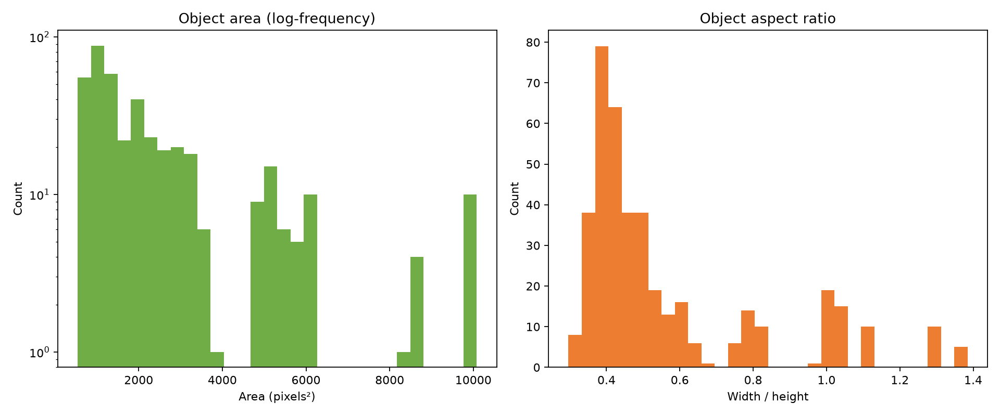

## 1. Problem, Data and Modeling

### 1.1 Overview and Problem Statement

The VisDrone2019-VID benchmark consists of high-resolution video frames (ranging from $680 \times 382$ to $1920 \times 1080$ pixels) captured from drone platforms. The main challenge comes from extreme scale variation, tiny target sizes, and severe object density (up to 180 objects per frame in crowded scenes). The objective is to accurately detect and classify objects across eight target classes: `person`, `bicycle`, `car`, `van`, `truck`, `tricycle`, `bus`, and `motor`.

### 1.2 Data Preparation and Exploration

To understand the data, exploratory data analysis (EDA) was conducted across the dataset. Here are the main findings:

* **Class Distribution:** The dataset exhibits extreme class imbalance. Categories such as `motor` and `person` dominate, whereas many other categories are severely underrepresented.



* **Object Sizes:** Approximately 88.5% of annotated objects fall into COCO-small ($\le 32 \times 32$ pixels) or COCO-medium categories. The median object area is $2,146\text{ px}^2$, with extreme aspect ratios ranging from $0.03$ (tall pedestrians) to $25.16$ (long vehicles). This observation motivated adopting higher input resolutions ($640 \times 640$ to $1024 \times 1024$).



* **Scene Density and Ignored Regions:** Frames contain an average of 44.9 objects, with dense clips reaching up to 180 objects. Furthermore, 71.0% of frames feature `ignore/` regions. To prevent the model from learning incorrect gradients by penalizing detections in unannotated crowds, I implemented pixel-level masking during training.

### 1.3 Validation Design and Protocol

Because consecutive frames in video sequences share high temporal correlation, random frame-level splitting causes severe data leakage. I merged all available video clips (63 total) and performed a strict sequence-level `GroupKFold` split (80% training / 20% validation, resulting in 50 training clips and 13 validation clips).

Controlled temporal subsampling of `5–35` was used during the model comparison phase because training was very long and it was hard to achieve meaningful results in one session, alongside Kaggle GPU resources being unavailable due to an unresolved technical issue. All models were evaluated under a consistent protocol using COCO metrics: Mean Average Precision ($\text{mAP}$), $\text{AP}_{50}$, $\text{AP}_{\text{small}}$, and inference speed ($\text{ms/img}$).

### 1.4 Model Families and Tuning Strategy

To compare different detection paradigms under limited GPU time, I tested four model families using a shared low-resolution screening protocol: `448x448` input size, `3` epochs, `batch size 32`, `frame_skip=35`, and `seed=42`, evaluated on `82` sampled validation frames across 7 clips. (Baseline runs in `hw_2.ipynb` used `max_detections=500`, while variant runs in `experiments.ipynb` used `max_detections=300`.)

1. **Two-Stage Anchor-Based (`Faster R-CNN` with ResNet50-FPN):** Uses a Region Proposal Network (RPN) to filter candidate regions before classifying and refining boxes in the second stage. Because VisDrone targets are tiny, I tested smaller anchor sizes (`exp1`: `16–256` px; `exp2`: `8–128` px) and increased post-NMS proposals (`2000` train / `1000` test). Note that while `exp1` also defined custom aspect ratios and $lr=0.0005$ in its config dictionary, the training loop kept $lr=0.005$ fixed.
2. **One-Stage Anchor-Based (`RetinaNet` with ResNet50-FPN):** Removes the proposal stage and predicts directly on dense multi-scale anchor grids, relying on Focal Loss to handle heavy background imbalance. Starting from defaults ($lr=0.0025$, $\alpha=0.25$, $\gamma=2.0$), `exp1` increased Focal Loss weighting ($\alpha=0.35$, $\gamma=2.5$) to focus on hard tiny targets, while `exp2` introduced custom small anchors (`8` to `203` px) with $\gamma=3.0$.
3. **One-Stage Anchor-Free (`YOLOv8n`):** Predicts object centers and box dimensions directly with task-aligned dynamic label assignment, avoiding rigid anchor shapes. From default loss weights (`box=7.5`, `cls=0.5`, `dfl=1.5`), `exp1` raised loss weights (`9.5 / 1.2 / 1.8`) to prioritize localization and classification, while `exp2` kept default weights and added light geometric/mosaic augmentations (`scale=0.15`, `translate=0.05`, `mosaic=0.25`, `close_mosaic=1`).
4. **Query-Based Transformer (`RT-DETR-L`):** Treats detection as direct set prediction via bipartite matching, removing Non-Maximum Suppression (NMS) so dense crowds are not suppressed by IoU thresholds. Starting from `300` queries and matching costs `2 / 5 / 2` (class / bbox / GIoU), `exp1` increased queries to `500` (to cover dense frames up to 180 objects) with costs `2.5 / 5 / 2.5`, while `exp2` tested `500` queries with default matching costs.

---

## 2. Results and Analysis

### 2.1 Benchmark Comparison

Table 1 reports validation metrics on the `82`-frame `448px` comparison split. Table 2 shows a separate checkpoint check on `265` validation frames across `13` clips (`frame_skip=20`, `max_detections=300`, `448px`), which was run to verify ranking stability across more clips. Public Kaggle leaderboard scores were not logged for these intermediate runs, as only the final pipeline submission was prepared for upload.

**Table 1: 448px Screening Benchmark (3 epochs, 82 validation frames, 7 clips)**

| Model Family | Variant | $\text{mAP@[.50:.95]}$ | $\text{AP}_{50}$ | $\text{AP}_{\text{small}}$ | Speed (ms/img) |
| :--- | :--- | :---: | :---: | :---: | :---: |
| Two-Stage Anchor-Based | Faster R-CNN (Baseline) | 0.0434 | 0.1014 | 0.0202 | 90.23 |
| Two-Stage Anchor-Based | Faster R-CNN (`exp1`: small anchors) | 0.0183 | 0.0601 | 0.0111 | 89.77 |
| Two-Stage Anchor-Based | Faster R-CNN (`exp2`: smaller anchors) | 0.0060 | 0.0261 | 0.0033 | 91.92 |
| One-Stage Anchor-Based | RetinaNet (Baseline) | 0.0032 | 0.0088 | 0.0007 | 55.21 |
| One-Stage Anchor-Based | RetinaNet (`exp1`: $\alpha=0.35, \gamma=2.5$) | 0.0041 | 0.0110 | 0.0008 | 57.45 |
| One-Stage Anchor-Based | RetinaNet (`exp2`: small anchors, $\gamma=3.0$) | 0.0000 | 0.0003 | 0.0000 | 66.17 |
| One-Stage Anchor-Free | YOLOv8n (Baseline) | 0.0827 | 0.1554 | 0.0173 | 44.91 |
| One-Stage Anchor-Free | YOLOv8n (`exp1`: loss weights) | 0.0618 | 0.1334 | 0.0263 | 51.78 |
| One-Stage Anchor-Free | YOLOv8n (`exp2`: augmentations) | 0.0881 | 0.1662 | 0.0196 | 47.31 |
| Query-Based | RT-DETR-L (Baseline: 300 queries) | **0.1283** | **0.2439** | **0.0424** | 90.93 |
| Query-Based | RT-DETR-L (`exp1`: 500 queries + costs) | 0.1024 | 0.2067 | 0.0360 | 104.34 |
| Query-Based | RT-DETR-L (`exp2`: 500 queries) | 0.1016 | 0.2022 | 0.0291 | 98.95 |

**Table 2: Secondary 265-Frame Checkpoint Check (448px, 13 clips, `max_det=300`)**

| Checkpoint | $\text{mAP@[.50:.95]}$ | $\text{AP}_{50}$ | Latency (ms/img) |
| :--- | :---: | :---: | :---: |
| Faster R-CNN (Baseline / `exp1` / `exp2`) | 0.0373 / 0.0204 / 0.0073 | 0.0971 / 0.0743 / 0.0315 | 68.34 / 88.29 / 88.49 |
| RetinaNet (`exp1` / `exp2`) | 0.0051 / 0.0001 | 0.0168 / 0.0003 | 59.65 / 58.57 |
| YOLOv8n (`exp1` / `exp2`) | 0.0888 / 0.0739 | 0.1871 / 0.1614 | 50.72 / 47.68 |
| RT-DETR-L (`exp1` / `exp2`) | **0.1265** / 0.1081 | **0.2708** / 0.2402 | 84.90 / 86.32 |

### 2.2 Key Findings and Unsuccessful Attempts

* **Query-based detection led across both benchmarks:** `RT-DETR-L` achieved `0.1283` mAP in Table 1 and `0.1265` mAP in Table 2, comfortably outperforming every CNN detector. It preserved small-object context (`0.0424` $\text{AP}_{\text{small}}$), and NMS-free bipartite matching prevented duplicate suppression in crowded scenes.
* **Anchor-free beat anchor-based models in both speed and accuracy:** `YOLOv8n` (`0.0881` mAP, `47.31` ms/img) doubled `Faster R-CNN` (`0.0434` mAP) while running nearly twice as fast. Dynamic task-aligned assignment adapted to tiny aerial boxes much better than fixed anchor grids. Notably, `YOLOv8n exp1` (higher loss weights) had the best $\text{AP}_{\text{small}}$ among CNNs (`0.0263`) and led `exp2` on the 265-frame check (`0.0888` vs `0.0739`), showing that short 3-epoch runs are sensitive to which clips are sampled.
* **Fail 1 — Tiny custom anchors on short runs:** Shrinking anchors down to `8 px` in `Faster R-CNN exp1/exp2` and `RetinaNet exp2` hurt performance (`0.0434 -> 0.0060` in Faster R-CNN; `0.0000` mAP in RetinaNet `exp2`). At `448px` with only 3 epochs, dense tiny anchors flooded the detector with noisy background matches, and raising Focal Loss $\gamma$ to `3.0` suppressed gradients too aggressively.
* **Fail 2 — 500 queries under a 3-epoch budget:** Increasing `RT-DETR-L` from `300` to `500` queries (`exp1`, `exp2`) lowered mAP (`0.1283 -> 0.1024`) and added ~`8–13 ms/img` latency because 500 queries need more than 3 epochs to converge.
* **Fail 3 — Low resolution (`448px`) and confidence threshold sweeps:** Downsampling `1920x1080` frames to `448px` erased too much spatial detail on tiny objects, capping $\text{AP}_{\text{small}}$ below `0.043` across all baselines. Later, on the `800px` model, sweeping lower confidence thresholds (`0.05` to `0.20`) slightly reduced validation mAP (`0.2173–0.2293` vs `0.2295` at `conf=0.25`), so `conf=0.25` was kept.

---

## 3. Final Model and Run Instructions

### 3.1 Selected Final Pipeline

Based on the screening results, I selected **Ultralytics `RT-DETR-L` (`rtdetr-l.pt`)** (`32.0M` parameters, `105.4` GFLOPs) with `500` queries and scaled up training to overcome the `448px` / `3-epoch` bottleneck:

* **Training setup:** `12` epochs at `800x800` resolution, `batch size 8`, `seed=42`, mixed precision (AMP), cosine learning rate schedule, `AdamW` (`lr=0.000833`, `momentum=0.9`), and `max_det=500` on a Tesla T4 GPU.
* **Data sampling:** `frame_skip=5`, yielding `4,841` training frames and `570` validation frames (`22,899` objects). (Because `/content/outputs/eda/sequence_split.csv` was not present during the final run, the notebook automatically fell back to scanning the default `train/` and `val/` directories; note also that the Ultralytics `data.yaml` used for the final run maps `pedestrian, people, bicycle, car, van, truck, tricycle, bus` rather than the `person...motor` order used in the `448px` scripts.)
* **Validation & submission:** Selecting `best.pt` (`/content/outputs/checkpoints/rtdetr_best_800px.pt`) over `last.pt` (`0.2063` mAP) improved validation performance to **`0.2295` $\text{mAP@[.50:.95]}$** and **`0.4453` $\text{AP}_{50}$** at **`25.1` ms/image** model forward speed. Inference at `imgsz=800`, `conf=0.25`, `max_det=500` generated `/content/outputs/submissions/submission.csv` (`3,811` test rows, `461,374` total boxes, ~`121.1` detections/frame).

### 3.2 Repository Structure and Environment

* `hw_2.ipynb`: Data exploration, annotation conversion, ignore-region masking, and `448px` baseline models.
* `experiments.ipynb`: Controlled hyperparameter/loss/augmentation experiments.
* `best_pipeline.ipynb`: Final `800px` `RT-DETR-L` training, validation check, test inference, and `submission.csv` verification.

**Dependencies:** Python `3.11.4`, CUDA-enabled PyTorch (`torch 2.14.1+cu130`, `torchvision 0.29.1+cu130`), `ultralytics>=8.4.213`, `torchmetrics`, `pycocotools`, `albumentations`, `opencv-python`, `scikit-learn`, `ensemble-boxes`, and `kaggle`.

### 3.3 How to Reproduce

1. **Install packages and download data:**
   ```bash
   pip install ultralytics torchmetrics pycocotools albumentations opencv-python scikit-learn ensemble-boxes kaggle
   kaggle competitions download -c multiple-object-video-detection-hw-2-ucu-ai-2026 -p /content
   unzip -q /content/multiple-object-video-detection-hw-2-ucu-ai-2026.zip -d /content/data